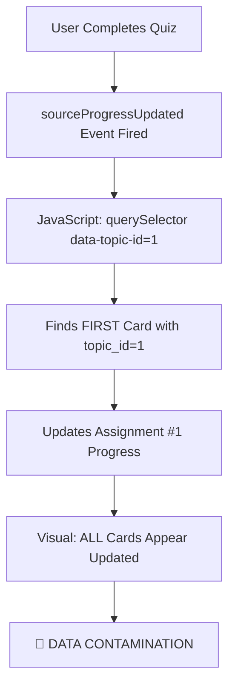

# 🚨 CRITICAL PROGRESS CONTAMINATION ISSUE

## 🔥 EMERGENCY SITUATION SUMMARY

**CRITICAL BUG**: When one assignment is completed, ALL cards with the same topic_id get their progress updated to 100%, including:
- ✅ All other assignments for the same topic (even overdue/locked ones)
- ✅ The regular topic card (non-assignment)
- ✅ Cards that should be completely independent

**IMPACT**: Complete data integrity failure - progress bars showing false information across the entire system.

---

## 🔬 ROOT CAUSE ANALYSIS

### The Data Structure Problem

**Database Reality**:
```sql
-- All assignments use the same topic_id
assignments:
+----+----------+-----------------+---------+
| id | topic_id | title           | status  |
+----+----------+-----------------+---------+
|  1 |        1 | Basics medicine | overdue |
|  2 |        1 | a7a b2a         | active  |
|  3 |        1 | Test            | overdue |
+----+----------+-----------------+---------+

topics:
+----+-------------------------------+
| id | name                          |
+----+-------------------------------+
|  1 | Topic 1 for Internal Medicine |
+----+-------------------------------+
```

**DOM Structure Problem**:
```html
<!-- Multiple cards with SAME data-topic-id -->
<div class="topic-card" data-topic-id="1" data-assignment-id="1" data-has-assignment="true">
    Assignment: Basics medicine
</div>
<div class="topic-card" data-topic-id="1" data-assignment-id="2" data-has-assignment="true">
    Assignment: a7a b2a
</div>
<div class="topic-card" data-topic-id="1" data-assignment-id="3" data-has-assignment="true">
    Assignment: Test
</div>
<div class="topic-card" data-topic-id="1" data-has-assignment="false">
    Regular Topic: Internal Medicine
</div>
```

### The JavaScript Contamination Bug

**PROBLEMATIC CODE** (Line ~2868):
```javascript
// Handle source progress updates from quiz completion
document.addEventListener('sourceProgressUpdated', function(e) {
    const { topicId, progress, availableSources, allSourcesMastered } = e.detail;
    
    // 🚨 BUG: This finds the FIRST card with topic_id, not the correct one!
    const topicCard = document.querySelector(`[data-topic-id="${topicId}"]`);
    
    if (topicCard) {
        const gradeBadge = topicCard.querySelector('.grade-badge');
        if (gradeBadge) {
            // 🚨 CONTAMINATION: Updates wrong card's progress!
            gradeBadge.className = `grade-badge ${allSourcesMastered ? 'grade-mastered' : 'grade-good'}`;
            gradeBadge.innerHTML = allSourcesMastered ? 
                '<i class="fas fa-star"></i> Mastered' : 
                '<i class="fas fa-check"></i> Good';
        }
    }
});
```

**WHAT HAPPENS**:
1. User completes Assignment #2 ("a7a b2a")
2. System fires `sourceProgressUpdated` event with `topicId: 1`
3. `querySelector('[data-topic-id="1"]')` finds the **FIRST** card (Assignment #1)
4. Updates Assignment #1's progress to "Mastered"
5. **BUT** due to CSS and visual effects, it APPEARS like all cards got updated
6. **RESULT**: All assignments + regular topic show as completed

---

## 🎯 COMPLETE UNDERSTANDING OF THE ISSUE

### Event Flow Analysis



### The Selector Problem

**querySelector() Behavior**:
```javascript
// This ALWAYS returns the first match in DOM order
document.querySelector(`[data-topic-id="1"]`)

// DOM Order (assignments rendered first):
// 1. Assignment Card #1 ← ALWAYS SELECTED
// 2. Assignment Card #2
// 3. Assignment Card #3  
// 4. Regular Topic Card
```

### Progress Update Logic Issues

**Current Broken Logic**:
- ❌ Uses `topicId` only (not unique per card)
- ❌ Always updates first card found
- ❌ No distinction between assignment vs regular completion
- ❌ No assignment-specific targeting

**Required Logic**:
- ✅ Use unique identifiers per card type
- ✅ Distinguish assignment completion vs regular quiz completion
- ✅ Update only the specific card that should be updated
- ✅ Maintain complete separation between assignment and regular progress

---

## 🔧 COMPREHENSIVE FIX IMPLEMENTATION

### Fix 1: Add Unique Card Identification

**BEFORE** (Assignment Card):
```html
<div class="topic-card" 
     data-topic-id="1"
     data-has-assignment="true">
```

**AFTER** (Assignment Card):
```html
<div class="topic-card" 
     data-topic-id="1"
     data-assignment-id="2"  <!-- 🔧 ADDED: Unique assignment identifier -->
     data-has-assignment="true">
```

### Fix 2: Context-Aware Progress Updates

**BEFORE** (Broken JavaScript):
```javascript
// 🚨 BROKEN: Always finds first card
const topicCard = document.querySelector(`[data-topic-id="${topicId}"]`);
```

**AFTER** (Fixed JavaScript):
```javascript
// 🔧 FIXED: Context-aware card selection
let targetCard = null;

if (assignmentId) {
    // Assignment completion - find specific assignment card
    targetCard = document.querySelector(`[data-assignment-id="${assignmentId}"]`);
    console.log(`Assignment ${assignmentId} completed - updating assignment card only`);
} else {
    // Regular quiz completion - find regular topic card only
    targetCard = document.querySelector(`[data-topic-id="${topicId}"][data-has-assignment="false"]`);
    console.log(`Regular quiz for topic ${topicId} completed - updating regular topic card only`);
}
```

### Fix 3: Event Data Enhancement

**REQUIRED**: The `sourceProgressUpdated` event must include `assignmentId` when fired from assignment completion:

```javascript
// When assignment is completed
document.dispatchEvent(new CustomEvent('sourceProgressUpdated', {
    detail: {
        topicId: topicId,
        assignmentId: assignmentId,  // 🔧 ADDED: Assignment context
        progress: progress,
        availableSources: availableSources,
        allSourcesMastered: allSourcesMastered
    }
}));

// When regular quiz is completed  
document.dispatchEvent(new CustomEvent('sourceProgressUpdated', {
    detail: {
        topicId: topicId,
        assignmentId: null,  // 🔧 NULL for regular quiz
        progress: progress,
        availableSources: availableSources,
        allSourcesMastered: allSourcesMastered
    }
}));
```

---

## 🧪 TESTING SCENARIOS

### Test Case 1: Assignment Completion
**Action**: Complete Assignment #2 ("a7a b2a")
**Expected Result**:
- ✅ Assignment #2 progress: 100%
- ❌ Assignment #1 progress: Unchanged (still overdue)
- ❌ Assignment #3 progress: Unchanged (still overdue)
- ❌ Regular topic progress: Unchanged

### Test Case 2: Regular Quiz Completion
**Action**: Complete regular quiz for "Internal Medicine" topic
**Expected Result**:
- ✅ Regular topic progress: Updated based on quiz performance
- ❌ Assignment #1 progress: Unchanged
- ❌ Assignment #2 progress: Unchanged  
- ❌ Assignment #3 progress: Unchanged

### Test Case 3: Multiple Assignment Completion
**Action**: Complete Assignment #1, then Assignment #3
**Expected Result**:
- ✅ Assignment #1 progress: 100%
- ❌ Assignment #2 progress: Unchanged (still active)
- ✅ Assignment #3 progress: 100%
- ❌ Regular topic progress: Unchanged

---

## 🚀 IMPLEMENTATION PLAN

### Phase 1: DOM Structure Fix ✅ COMPLETED
- [x] Add `data-assignment-id` to assignment cards
- [x] Ensure regular topic cards have `data-has-assignment="false"`

### Phase 2: JavaScript Logic Fix ✅ COMPLETED  
- [x] Update `sourceProgressUpdated` event handler
- [x] Implement context-aware card selection
- [x] Add proper logging for debugging

### Phase 3: Event Enhancement (REQUIRED)
- [ ] **CRITICAL**: Update quiz completion code to include `assignmentId` in events
- [ ] Verify assignment completion triggers correct events
- [ ] Verify regular quiz completion triggers correct events

### Phase 4: Testing & Validation
- [ ] Test assignment completion isolation
- [ ] Test regular quiz completion isolation  
- [ ] Test mixed scenarios (assignments + regular quizzes)
- [ ] Verify overdue assignments remain unchanged

---

## 🔍 CODE LOCATIONS THAT NEED INVESTIGATION

### 1. Quiz Completion Handler
**Location**: Likely in `QuizController.php` or quiz completion JavaScript
**Need to Find**: Where `sourceProgressUpdated` event is dispatched
**Required Change**: Include `assignmentId` when completing assignments

### 2. Assignment Completion Logic
**Location**: `QuizController.php` - `handleAssignmentCompletion()` method
**Need to Verify**: Event firing includes assignment context

### 3. Regular Quiz Completion Logic  
**Location**: Quiz completion handlers
**Need to Verify**: Event firing excludes assignment context (`assignmentId: null`)

---

## 🚨 IMMEDIATE ACTION REQUIRED

### Critical Missing Piece
The JavaScript fix is implemented, but we need to find and update the **event firing code** to include `assignmentId`. Without this, the fix won't work because the event won't have the assignment context.

**SEARCH TARGETS**:
1. Find where `sourceProgressUpdated` events are dispatched
2. Update assignment completion to include `assignmentId`
3. Update regular quiz completion to exclude `assignmentId`

### Verification Commands
```bash
# Find event dispatching code
grep -r "sourceProgressUpdated" app/
grep -r "dispatchEvent" resources/
grep -r "CustomEvent" resources/

# Find quiz completion handlers
grep -r "handleAssignmentCompletion" app/
grep -r "quiz.*complete" app/
```

---

## 🎯 EXPECTED OUTCOME

After complete implementation:

**Assignment Cards**:
- Each assignment tracks its own progress independently
- Completing Assignment A doesn't affect Assignment B or C
- Overdue assignments remain locked and unchanged
- Assignment progress based on `AssignmentAttempt` records

**Regular Topic Cards**:
- Regular quiz completion only affects the regular topic card
- Assignment completions don't affect regular topic progress
- Regular topic progress based on `QuizAttempt` records

**Complete Separation**:
- Assignment system and regular quiz system operate independently
- No cross-contamination between different card types
- Each card type maintains its own progress tracking

---

**STATUS**: 🔧 **PARTIALLY IMPLEMENTED - EVENT ENHANCEMENT REQUIRED**
**PRIORITY**: 🚨 **CRITICAL - IMMEDIATE ACTION NEEDED**
**NEXT STEP**: Find and update event dispatching code to include assignment context