# Database ER Diagram

Generated from migration analysis on 2025-08-06 13:46:10

```mermaid
erDiagram

    users {
        BIGINT id PK
        STRING name
        STRING email
        STRING password
        STRING role
        STRING university
        STRING profile_picture_url
        INTEGER correct_answers_count
        INTEGER total_questions_attempted
        INTEGER xp
        INTEGER level
        INTEGER study_streak_days
        TIMESTAMP email_verified_at
        TIMESTAMP last_active_at
        TIMESTAMP last_study_date
        TIMESTAMP id
    }

    password_reset_tokens {
        STRING email
        STRING token
        TIMESTAMP created_at
    }

    sessions {
        STRING id
        STRING ip_address
        STRING fingerprint
        INTEGER last_activity
        TEXT user_agent
        BOOLEAN is_visitor
    }

    cache {
        STRING key
        INTEGER expiration
    }

    cache_locks {
        STRING key
        STRING owner
        INTEGER expiration
    }

    jobs {
        BIGINT id PK
        STRING queue
    }

    job_batches {
        STRING id
        STRING name
        INTEGER total_jobs
        INTEGER pending_jobs
        INTEGER failed_jobs
        INTEGER cancelled_at
        INTEGER created_at
        INTEGER finished_at
    }

    failed_jobs {
        BIGINT id PK
        STRING uuid
        TEXT connection
        TEXT queue
        TIMESTAMP failed_at
    }

    courses {
        BIGINT id PK
        STRING name
        STRING academic_year
        STRING image
        STRING color
        STRING title_color
        STRING image_path
        TEXT description
        BOOLEAN is_active
        TIMESTAMP id
    }

    tutor_student_relationships {
        BIGINT id PK
        TIMESTAMP assigned_at
        TIMESTAMP id
    }

    topics {
        BIGINT id PK
        STRING name
        STRING case_type
        INTEGER display_order
        BOOLEAN is_locked
        TIMESTAMP id
    }

    questions {
        BIGINT id PK
        STRING image_url
        STRING source
        STRING option_a
        STRING option_b
        STRING option_c
        STRING option_d
        STRING question_type
        INTEGER total_attempts
        INTEGER correct_attempts
        TEXT question
        TEXT explanation
        TEXT correct_answer
        TIMESTAMP last_attempted_at
        TIMESTAMP id
    }

    mistakes {
        BIGINT id PK
        STRING submitted_answer
        STRING correct_answer
        STRING image_path
        INTEGER correct_streak
        INTEGER quick_correct_count
        INTEGER quiz_correct_count
        TEXT question_text
        BOOLEAN mastered
        BOOLEAN skipped
        TIMESTAMP last_attempt_date
        TIMESTAMP id
    }

    course_user {
        BIGINT id PK
        BOOLEAN is_enrolled
        TIMESTAMP enrolled_at
        TIMESTAMP id
    }

    quiz_attempts {
        BIGINT id PK
        STRING quiz_type
        STRING study_mode
        STRING source
        INTEGER correct_answers
        TIMESTAMP id
    }

    user_topic_progress {
        BIGINT id PK
        TIMESTAMP last_attempt_date
        TIMESTAMP id
    }

    notifications {
        BIGINT id PK
        STRING title
        STRING type
        TEXT message
        BOOLEAN is_read
        TIMESTAMP read_at
        TIMESTAMP id
    }

    assignments {
        BIGINT id PK
        STRING title
        STRING assignment_mode
        STRING assigned_source
        TIMESTAMP id
    }

    payments {
        BIGINT id PK
        STRING reference_number
        STRING payment_method
        STRING status
        BOOLEAN is_bundle
        TIMESTAMP paid_at
        TIMESTAMP id
    }

    assignment_users {
        BIGINT id PK
        TIMESTAMP id
    }

    session_security_logs {
        BIGINT id PK
        STRING event_type
        STRING ip_address
        STRING device_fingerprint
        TEXT user_agent
        BOOLEAN action_taken
        TIMESTAMP id
    }


```

## Metadata

- **Tables**: 21
- **Relationships**: 0
- **Migration Files Analyzed**: 19
- **Generated**: 2025-08-06 13:46:10

## Table Details

### users
- **Migration**: `database/migrations/0001_01_01_000000_create_users_table.php`
- **Columns**: 16

### password_reset_tokens
- **Migration**: `database/migrations/0001_01_01_000000_create_users_table.php`
- **Columns**: 3

### sessions
- **Migration**: `database/migrations/0001_01_01_000000_create_users_table.php`
- **Columns**: 6

### cache
- **Migration**: `database/migrations/0001_01_01_000001_create_cache_table.php`
- **Columns**: 2

### cache_locks
- **Migration**: `database/migrations/0001_01_01_000001_create_cache_table.php`
- **Columns**: 3

### jobs
- **Migration**: `database/migrations/0001_01_01_000002_create_jobs_table.php`
- **Columns**: 2

### job_batches
- **Migration**: `database/migrations/0001_01_01_000002_create_jobs_table.php`
- **Columns**: 8

### failed_jobs
- **Migration**: `database/migrations/0001_01_01_000002_create_jobs_table.php`
- **Columns**: 5

### courses
- **Migration**: `database/migrations/2024_03_20_000000_create_courses_table.php`
- **Columns**: 10

### tutor_student_relationships
- **Migration**: `database/migrations/2024_03_21_000002_create_tutor_student_relationships_table.php`
- **Columns**: 3

### topics
- **Migration**: `database/migrations/2024_03_21_000003_create_topics_table.php`
- **Columns**: 6

### questions
- **Migration**: `database/migrations/2024_03_21_000004_create_questions_table.php`
- **Columns**: 15

### mistakes
- **Migration**: `database/migrations/2024_03_21_000007_create_mistakes_table.php`
- **Columns**: 12

### course_user
- **Migration**: `database/migrations/2024_03_21_000009_create_course_user_table.php`
- **Columns**: 4

### quiz_attempts
- **Migration**: `database/migrations/2024_03_21_000009_create_quiz_attempts_table.php`
- **Columns**: 6

### user_topic_progress
- **Migration**: `database/migrations/2024_03_22_000001_create_user_topic_progress_table.php`
- **Columns**: 3

### notifications
- **Migration**: `database/migrations/2024_04_21_000001_create_notifications_table.php`
- **Columns**: 7

### assignments
- **Migration**: `database/migrations/2025_01_19_000001_create_assignments_table.php`
- **Columns**: 5

### payments
- **Migration**: `database/migrations/2025_04_12_040013_create_payments_table.php`
- **Columns**: 7

### assignment_users
- **Migration**: `database/migrations/2025_08_03_034733_create_assignment_users_table.php`
- **Columns**: 2

### session_security_logs
- **Migration**: `database/migrations/2025_08_05_000001_add_comprehensive_session_security.php`
- **Columns**: 7

